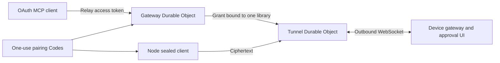

# Architecture and trust boundaries

The root Gateway owns OAuth clients, approval selections, authorization codes,
grants and token sessions. Each Tunnel owns one library's device sockets, secret
hash, public key, optional sealed queue and optional wake settings. Codes maps
short-lived codes to a tunnel and public key. Each is a Cloudflare SQLite Durable
Object. Rate counters and active request maps also live in memory.

## Inbound MCP OAuth

The relay is both authorization server and protected resource. A registered client
requests an exact resource audience, uses S256 PKCE and asks the user to select and
approve a device. The relay obtains a separately scoped device agent key after
approval and stores it with the grant. The OAuth client gets an opaque relay token;
it never receives the device agent key or tunnel secret.

`/mcp` validates the bearer before admitting its body and revalidates in the
Gateway. The grant selects the library; request arguments cannot choose another.
Metadata uses configured `RELAY_ORIGIN`, never an untrusted Host. Changing that
origin changes audiences and requires reconnecting clients. Root and tunnel
audiences remain separate; legacy tunnel token exchanges permit omitted resource
for compatibility. Access expires after one hour. Refresh expires after 30 days
and rotates once under an atomic transaction. Relay revocation invalidates all
access and refresh sessions belonging to the grant.

## Downstream provider OAuth

There are no Google, Microsoft or other provider OAuth adapters here. The device
agent key is a separate credential used only for the approved device gateway. A
client's inbound bearer must never be forwarded to an unrelated API. A provider
integration needs its own consent, audience, credential storage and revocation
contract in a separate adapter.

## What the operator can see

| Path | Relay visibility and storage |
| --- | --- |
| OAuth MCP | Plain requests and replies; approved device key; clients, grants and token sessions |
| Sealed Node bridge | Tunnel, device/caller metadata, timing and ciphertext size; sealed payloads may be queued |
| Optional hosted agent | Selected content decrypted for inference; an answer key stored when enabled |
| Optional Apple push | Device tokens, configured Apple identity and push timing |

Device key verification matters: pin the `#k=` address or compare the safety code
on both devices during short-code pairing. An operator that substitutes an
unverified key can defeat the intended sealed-channel trust. Neither path claims
zero knowledge. Durable Object storage is operated by the hosting provider.

## The door

The door (`/door/mcp`) passes a chat app's MCP calls to one configured
upstream after checking the token that app holds from an external identity service.
The operator can read those calls while they pass through, and the upstream's
answers coming back. The door holds no credential and stores nothing about the
calls: no database writes, no logs. Only in-memory rate counters exist. The
upstream gets the same `Authorization` header and decides what each tool may do;
the door has no tool list of its own.
The door is meant for staging. That is the operator's choice: the code does not enforce it, and the door is on wherever its three variables are set.
`GET` and `DELETE` on `/door/mcp` answer 405. Addresses are counted per IPv6 /64.
The door does not forward client-sent JSON-RPC responses, so upstream elicitation and sampling are not available through it, and an upstream stream is cut at 30 seconds.

## Availability, revocation and retries

A device must stay connected to serve reads and OAuth. Mac sockets take precedence;
otherwise the newest device is chosen. APNs wake is optional and best effort.
Reconnect replaces that device's old socket; a stale socket cannot answer or fail
a new socket's requests.

OAuth calls are never queued or automatically retried. Offline devices return 503;
lost replies may return 503/504 with uncertain write outcomes. Reconcile before
retrying. Sealed writes marked for queueing can wait seven days, up to 200 per
library. `202` means queued, not applied. A device must persist command IDs and
enforce replay protection; the relay alone does not guarantee exactly-once execution.

Device revocation is discovered when the device returns 401 on a call. An offline
device cannot immediately notify the relay; refresh may still succeed until the
grant is revoked at the relay, the device responds, or sessions expire. This is a
known consistency limit. Relay token revocation is immediate for its grant.

Bodies are bounded at 2 MB, concurrent readers/replies at 32, and body/reply
deadlines at 30 seconds. OAuth has a separate reader pool. Per-address, per-grant
and per-library limits are application guards; exposed services also need
infrastructure abuse controls. The global OAuth registry holds 500 clients and
recycles unused registrations. Production operators must monitor limits/storage
growth and define retention, deletion, backup and incident procedures.
